# When Should a Production Model Be Retrained? An Empirical Study of Drift Detectors and Drift-Triggered Retraining

*Research component of the Customer Churn MLOps project. All numbers in this report are produced by
`dvc repro research/dvc.yaml`; tables are in `research/results/tables/`, figures in `research/figures/`.*

---

## Abstract

MLOps platforms monitor deployed models for *data drift* and often retrain them automatically when
drift is detected. Whether this is a good idea depends on two questions that are rarely tested
together: (i) does the drift detector fire on the drift that actually matters, and (ii) does
retraining after an alarm improve the model? We evaluate seven drift detectors (five unsupervised:
PSI, KS/χ², MMD, classifier two-sample test, prediction drift; two supervised: performance drop,
DDM) and ten retraining policies on the IBM Telco churn data used by our production system. We
inject four controlled drift types (subpopulation shift, feature inflation, a data-pipeline bug, and
real concept drift), in sudden and gradual form, and replicate each condition 50 times with
independent data splits and models. We validate the conclusions on Elec2, a standard benchmark
with naturally occurring drift. All detectors are calibrated to a common 1 % per-batch
false-alarm rate, so they are compared on equal terms. Statistical significance is assessed with
Friedman/Nemenyi and Holm-corrected Wilcoxon tests.

Four findings stand out. **(1) What is detectable is not what is harmful.** The only drift that
seriously damages the model (concept drift, −0.33 ROC-AUC) is invisible to every unsupervised
detector (detection AUC ≈ 0.5). Meanwhile a 25 % price inflation is detected in 100 % of runs and
costs only 0.007 AUC. **(2) Out-of-the-box thresholds are unreliable.** At default thresholds MMD
and C2ST raise false alarms on 22 % and 16 % of clean batches. **(3) On Telco, retraining
triggered by unsupervised detectors performs *worse* than never retraining** (mean −0.002 to −0.003
AUC), because it reacts to harmless covariate shift and discards training data. Label-based
triggering (PerfDrop) recovers 90 % of the oracle's benefit on harmful drift with 77 % fewer
retrains than a fixed schedule. **(4) The best trigger is dataset-dependent.** On Elec2, where drift
is largely in the inputs, KS-triggered retraining matches retraining every week (p = 0.59) with
64 % fewer retrains, and the supervised triggers fall behind. Label delay erodes the benefit of
label-based triggers: about 36 % of PerfDrop's gain is lost at a delay of 5 batches.

---

## 1. Introduction

A deployed model silently degrades when the world it was trained on changes. MLOps tooling
responds with drift monitoring. Population Stability Index (PSI) dashboards and statistical tests on
the input features are the industry default, and they are often wired directly to automatic
retraining. Our own churn API ships with exactly this PSI check (`src/churn/monitoring/drift.py`,
threshold 0.2).

This practice rests on an unexamined chain of assumptions: input drift ⇒ model degradation ⇒
retraining helps. Each link can fail:

* **Concept drift** (a change in P(y | x)) degrades the model without changing the inputs, so input
  monitors cannot see it.
* **Covariate shift** (a change in P(x) with P(y | x) unchanged) changes the inputs, often with
  little effect on a well-specified model.
* **Retraining is not free**: it uses a smaller, recent window of labelled data, needs labels that
  arrive late, and costs compute and review effort.

### Research questions

| | Question | Experiment |
|---|---|---|
| **RQ1** | How well do common drift detectors detect different types of drift at an equal false-alarm rate, and how quickly? | Exp 1 |
| **RQ2** | How sensitive is each detector to drift *magnitude*, and does that sensitivity track the harm to the model? | Exp 3 |
| **RQ3** | Does drift-triggered retraining improve post-drift performance compared with never retraining, periodic retraining and an oracle, and at what retraining cost? | Exp 2 |
| **RQ4** | How does label delay affect label-based retraining triggers? | Exp 2b |
| **RQ5** | Do the conclusions hold on a real-world stream with natural drift? | Exp 4 |

### Contributions

1. A reproducible, DVC-orchestrated benchmark (`src/driftlab/`, about 1,700 lines) that reuses the
   production churn system's data and model family.
2. A *paired* comparison of detection quality and downstream retraining value at a calibrated, equal
   false-alarm rate, with significance tests.
3. Practical guidance for the churn system's monitoring design (Section 6.2).

---

## 2. Background and Related Work

**Drift taxonomy.** Gama et al. (2014) and Moreno-Torres et al. (2012) distinguish *virtual drift*
/ covariate shift (P(x) changes) from *real concept drift* (P(y | x) changes). Only the latter
necessarily invalidates the learned decision function.

**Unsupervised detectors** compare a reference window to the current batch. PSI is the industry
standard in credit risk and is usually read with the 0.1 / 0.2 rule of thumb. Univariate KS and χ²
tests with a multiple-testing correction are a strong baseline for detecting dataset shift
(Rabanser et al., 2019). Kernel Maximum Mean Discrepancy (Gretton et al., 2012) and classifier
two-sample tests (Lopez-Paz & Oquab, 2017) are multivariate alternatives. Monitoring the model's
output distribution ("prediction drift") is a cheap proxy.

**Supervised detectors** need ground-truth labels. DDM (Gama et al., 2004) tracks the online error
rate; a simple alternative is to alarm when a performance metric drops below its reference.

**Evaluation methodology.** We follow Demšar (2006) for comparing several methods over many
problems: the Friedman test, followed by the Nemenyi post-hoc test and critical-difference (CD)
diagrams. Pairwise comparisons against the best method use Wilcoxon signed-rank tests with Holm
correction.

---

## 3. Methodology

### 3.1 Data and model

* **Telco** (IBM Telco Customer Churn, 7,043 customers, 19 features, 26.5 % churn). This is the
  production dataset of this project.
* **Elec2** (Harries, 1999): 45,312 half-hourly records of the New South Wales electricity market,
  1996–1998. The target is whether the price goes up. This is a widely used benchmark with real,
  undocumented drift.
* **Model:** the production model family. A scikit-learn pipeline (standardisation + one-hot
  encoding) feeds a `HistGradientBoostingClassifier` (150 iterations, depth 4).

### 3.2 Experimental protocol (Telco)

Each of **10 outer repetitions** draws a new stratified, *disjoint* split of the data and trains a
new model:

| Pool | Share | Use |
|---|---|---|
| train | 30 % | fit the deployed model (≈2,100 rows) |
| reference | 10 % | detector reference window |
| calibration | 10 % | clean streams for threshold calibration |
| stream | 25 % | operational batches (also the retraining data) |
| evaluation | 25 % | leakage-free performance measurement |

From each split we generate **5 independent streams** of **40 batches × 200 records**. Drift starts
at batch 15. Under *gradual* drift the share of drifted records ramps linearly to 100 % over 10
batches. This gives **50 runs per condition**. Labels arrive **2 batches** after prediction.
Supervised detectors therefore score batch *t − 2* at time *t*. Performance at batch *t* is always
measured on an independent sample from the evaluation pool under the same drift condition, so a
retrained model is never scored on rows it was trained on.

### 3.3 Drift scenarios

| Scenario | What changes | Mechanism (default severity) | Drift type |
|---|---|---|---|
| `none` | nothing | control stream | n/a |
| `subpopulation` | P(x) | customers resampled with log-odds +1.5 for month-to-month and tenure < 12 | covariate shift |
| `inflation` | P(x) | MonthlyCharges and TotalCharges × 1.25 | covariate shift |
| `sensor_bug` | P(x) | tenure logged in days instead of months (× 30) | data-quality incident |
| `concept` | P(y \| x) | 50 % of loyal (tenure > 24) non-churners now churn; 50 % of new (tenure < 12) churners now stay | real concept drift |

### 3.4 Detectors

All detectors return a scalar score per batch (higher = more drift). Each has a practitioner
**default threshold** and a **calibrated threshold**. The calibrated threshold is the 99th
percentile of the detector's score on 30 clean, no-drift streams drawn from the held-out
calibration pool, which is a **1 % per-batch false-positive rate** for every detector.

| Detector | Type | Score | Default threshold |
|---|---|---|---|
| PSI | unsupervised | max PSI over features (10 quantile bins) | 0.2 |
| KS | unsupervised | −log₁₀ of the Bonferroni-corrected min p-value (KS / χ²) | p < 0.05 |
| MMD | unsupervised | RBF-kernel MMD², median-heuristic bandwidth | 95th pct. of bootstrap null |
| C2ST | unsupervised | out-of-bag AUC of a random forest separating reference from batch | one-sided 95 % bound under H₀ |
| PredDrift | unsupervised | −log₁₀ p of KS test on predicted probabilities | p < 0.05 |
| PerfDrop | supervised | reference AUC − batch AUC | 0.05 |
| DDM | supervised | (p + s − p_min) / s_min on the error stream | 3σ |

### 3.5 Retraining policies

| Policy | Rule |
|---|---|
| `static` | never retrain (lower reference) |
| `periodic` | retrain every 10 batches |
| `oracle` | retrain at the known drift onset, as soon as 3 labelled drifted batches exist, and again once the window is full |
| `<detector>` | on an alarm, wait until 3 labelled batches of the new regime exist, then retrain; 3-batch cooldown |

Retraining uses the last **8 labelled batches** (1,600 rows). After a retrain the detector's
reference is rebuilt from out-of-fold predictions on the new training window.

### 3.6 Metrics and statistics

* **Detection (Exp 1, 3):** detection rate (any alarm after onset); delay (batches from onset to the
  first alarm); **detection AUC**, a threshold-free score that is the ROC-AUC of the detector score
  separating pre-onset batches from fully drifted batches; per-batch false-alarm rate on `none`
  streams.
* **Retraining (Exp 2, 4):** mean post-onset ROC-AUC (Telco) or prequential accuracy (Elec2); gain
  vs. `static`; number of retrains; false retrains (before onset or with no drift).
* **Tests:** Friedman test over blocks (Exp 1: 400 runs; Exp 2: 450 runs; Exp 4: 126 weeks),
  Nemenyi critical difference at α = 0.05, and Wilcoxon signed-rank tests of the best method against
  every other method with Holm correction.

### 3.7 Elec2 protocol (Exp 4)

Weekly batches of 336 records are used. Weeks 0–3 train the initial model and weeks 4–7 calibrate
the thresholds. The model is then evaluated prequentially on the remaining **126 weeks**, with
labels available immediately (delay 0), a 4-week retraining window, periodic retraining every 4
weeks, and an `always` baseline that retrains every week. Results are averaged over 5 seeds.

---

## 4. Results

### 4.1 Not all drift is harmful

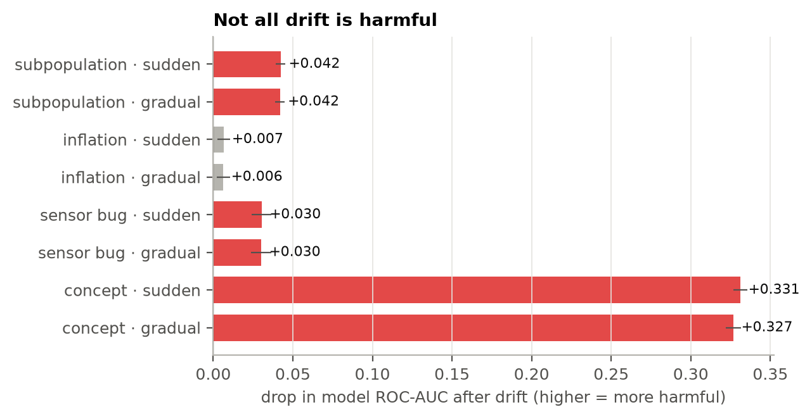

| Scenario | AUC before | AUC after | Drop (±95 % CI) |
|---|---|---|---|
| concept (sudden / gradual) | 0.838 | 0.507 / 0.512 | **0.331** / **0.327** (±0.005) |
| subpopulation | 0.838 | 0.796 | 0.042 (±0.003) |
| sensor bug | 0.838 | 0.808 | 0.030 (±0.006) |
| inflation | 0.838 | 0.832 | 0.007 (±0.004) |
| none | 0.838 | 0.840 | −0.002 (±0.003) |

Concept drift pushes the model to chance level. The three covariate-shift scenarios cost between
0.007 and 0.042 AUC, because gradient-boosted trees are fairly robust to monotone rescaling and to
changes in subgroup mix when P(y | x) is unchanged.

### 4.2 RQ1: Detection performance (Exp 1)

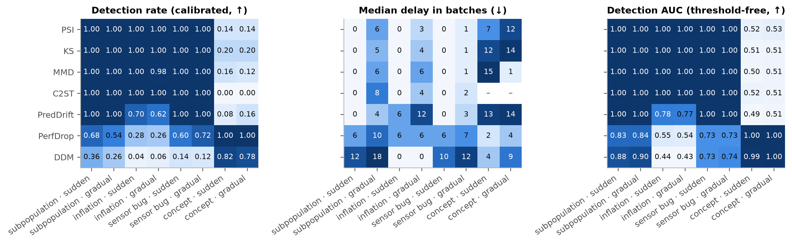

| Detector | Detection rate | Median delay | Detection AUC | False alarms (default) | False alarms (calibrated) |
|---|---|---|---|---|---|
| PSI | 0.785 | 1 | **0.882** | 0.2 % | 0.4 % |
| KS | 0.800 | 1 | 0.878 | 5.2 % | 0.6 % |
| C2ST | 0.750 | 1 | 0.878 | 16.4 % | 0.0 % |
| MMD | 0.782 | 1 | 0.876 | 21.6 % | 0.5 % |
| PredDrift | 0.695 | 2 | 0.817 | 6.0 % | 0.7 % |
| PerfDrop | 0.635 | 4 | 0.778 | 4.7 % | 1.7 % |
| DDM | 0.323 | 9 | 0.765 | 8.4 % | 2.6 % |

**Detection AUC:** Friedman χ² = 400.0, p = 2.8 × 10⁻⁸³ (k = 7, N = 400), Nemenyi CD = 0.45.

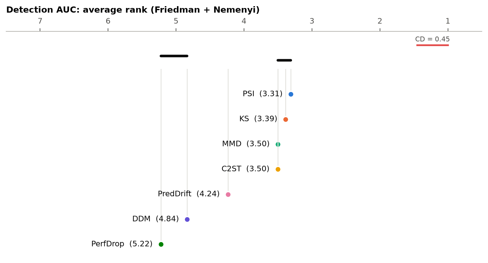

* **The four unsupervised input detectors are statistically indistinguishable.** PSI ranks first,
  but its Holm-corrected Wilcoxon difference from KS (p = 0.50), MMD (p = 0.071) and C2ST
  (p = 0.071) is not significant. All four are significantly better than PredDrift, PerfDrop and
  DDM.
* **They detect all three covariate-shift scenarios in 98–100 % of runs, usually within one batch, but
  they detect concept drift in only 0–20 % of runs.** Their detection AUC on concept drift is
  0.50–0.53, which is chance level. Their apparent concept "detections" are false alarms: with a 1 %
  per-batch rate over 25 post-onset batches, about 22 % of runs contain at least one alarm by chance.
* **The supervised detectors show the mirror-image pattern.** PerfDrop detects concept drift in 100 %
  of runs (detection AUC 1.00) and inflation in only 26–28 %. This matches the harm in Section 4.1.
* **Default thresholds are not comparable.** At their textbook thresholds MMD and C2ST alarm on 22 %
  and 16 % of clean batches. In a 40-batch stream that is 6–9 false alarms. In this setting PSI's
  0.2 rule of thumb happens to be almost exactly calibrated (calibrated threshold 0.194 at 200
  records per batch). PSI depends on sample size, however, so this does not carry over to other
  batch sizes (see Exp 4).

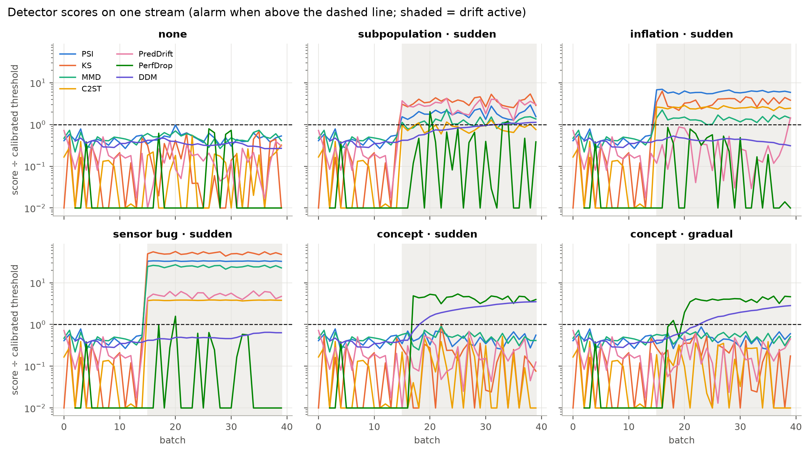

### 4.3 RQ2: Sensitivity to drift magnitude (Exp 3)

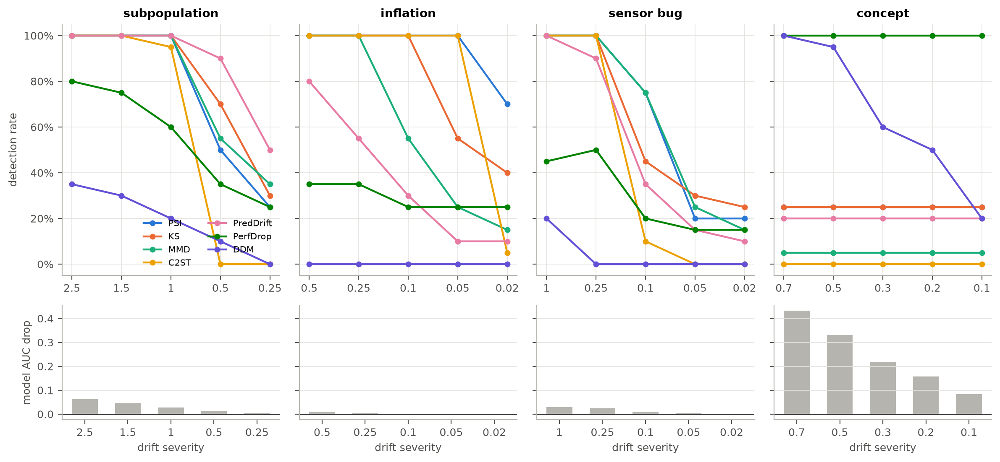

20 severities (5 per drift type) × 20 runs each, sudden drift, calibrated thresholds.

* For covariate shift, detection rises steeply with severity. PSI already detects a **2 % price
  inflation in 70 % of runs**, which causes zero measurable harm (AUC drop −0.002). Unsupervised
  detectors are therefore *over-sensitive* relative to harm, and their alarm rate says little about
  model damage.
* For concept drift, the unsupervised detectors stay at their chance floor (0–25 %) **at every
  severity**, including severity 0.7, where AUC falls by 0.43. PerfDrop detects concept drift in
  100 % of runs from the weakest severity (0.1, AUC drop 0.083). DDM's detection rate grows with
  severity, from 20 % to 100 %.

### 4.4 RQ3: Value of drift-triggered retraining (Exp 2)

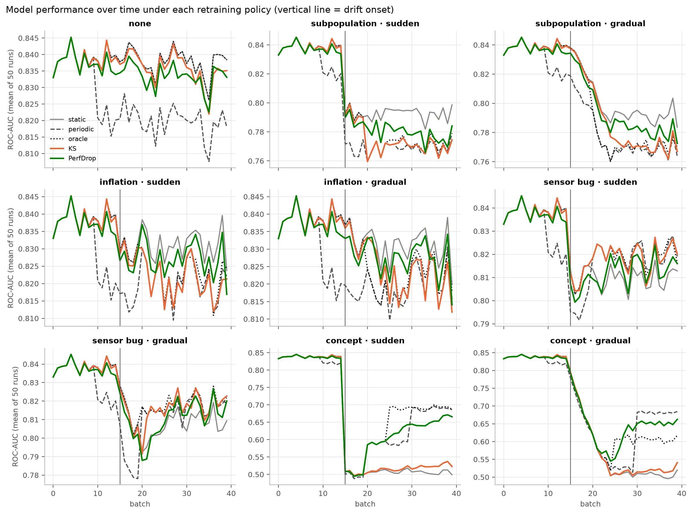

Post-onset ROC-AUC, mean over 450 runs (9 scenarios × 50), label delay = 2:

| Policy | Post-drift AUC | Gain vs static | Gain on harmful drift¹ | Retrains / stream | False retrains | Retrains with no drift |
|---|---|---|---|---|---|---|
| oracle | 0.770 | +0.017 | +0.051 | 1.78 | 0.00 | 0.00 |
| **PerfDrop** | **0.770** | **+0.017** | **+0.046** | 0.93 | 0.18 | 0.22 |
| DDM | 0.765 | +0.012 | +0.029 | 0.39 | 0.10 | 0.10 |
| periodic | 0.764 | +0.011 | +0.046 | 4.00 | 1.33 | 4.00 |
| static | 0.753 | 0 | 0 | 0 | 0 | 0 |
| KS | 0.751 | −0.002 | +0.008 | 1.56 | 0.08 | 0.20 |
| MMD | 0.751 | −0.002 | +0.006 | 1.25 | 0.01 | 0.12 |
| PSI | 0.751 | −0.002 | +0.007 | 1.47 | 0.07 | 0.12 |
| PredDrift | 0.750 | −0.003 | +0.005 | 1.04 | 0.12 | 0.28 |
| C2ST | 0.750 | −0.003 | +0.004 | 1.15 | 0.00 | 0.00 |

¹ concept and sensor-bug scenarios.

**Post-drift AUC:** Friedman χ² = 332.0, p = 4.3 × 10⁻⁶⁶ (k = 10, N = 450), Nemenyi CD = 0.64.

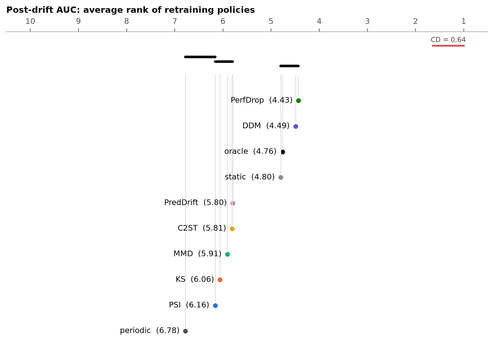

* **PerfDrop is the best non-oracle policy.** It is significantly better than `static`
  (Holm p = 0.0014), than `periodic`, and than every unsupervised trigger (all Holm p < 10⁻¹³). It is
  not significantly different from DDM (p = 0.060) or from the oracle (p = 0.12).
* **Unsupervised triggers are worse than never retraining.** They fire on harmless subpopulation and
  inflation drift and replace a model trained on ≈2,100 rows with one trained on 1,600 recent rows.
  On subpopulation drift this costs 0.012–0.020 AUC. On concept drift, where retraining is needed,
  they rarely fire (gain ≤ +0.010, against +0.098 for PerfDrop on concept-sudden).
* **Retraining hurts under pure covariate shift even when it is perfectly timed.** The oracle also
  loses 0.017–0.018 AUC on subpopulation drift and 0.007 on inflation. When P(y | x) is unchanged,
  the old model is still correct, and a smaller retraining window only adds variance.
* **The cost side.** `periodic` gets the same harmful-drift gain as PerfDrop (+0.046) but retrains
  4.3× as often. All 4 of its retrains per no-drift stream are unnecessary, and on no-drift streams
  it lowers AUC by 0.018.
* The oracle is not an upper bound under gradual drift. It retrains at two fixed times while the
  concept is still changing, so PerfDrop (0.641) and periodic (0.632) beat it on concept-gradual
  (0.621).

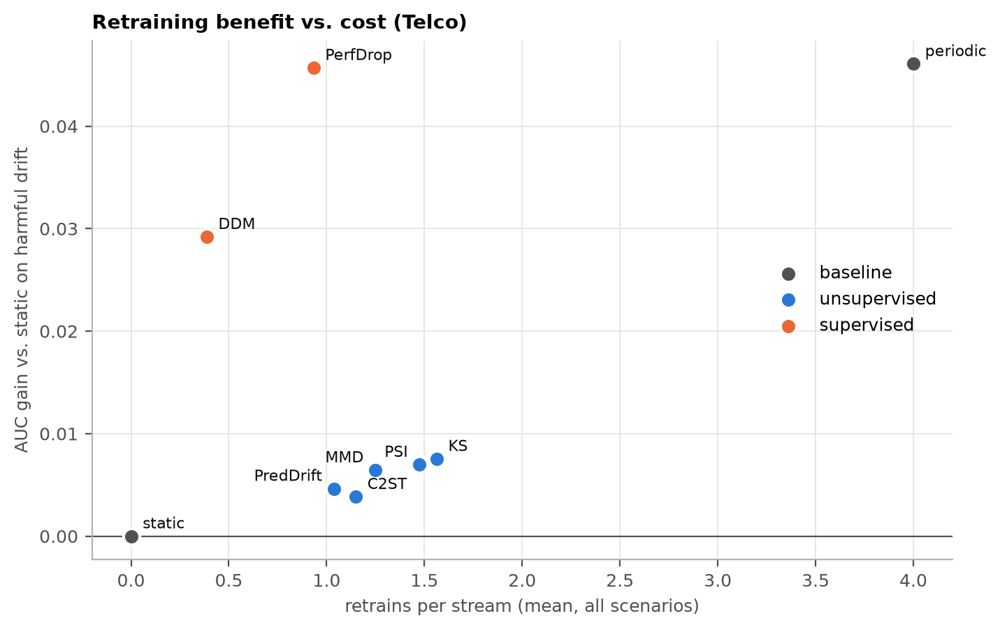

### 4.5 RQ4: Effect of label delay (Exp 2b)

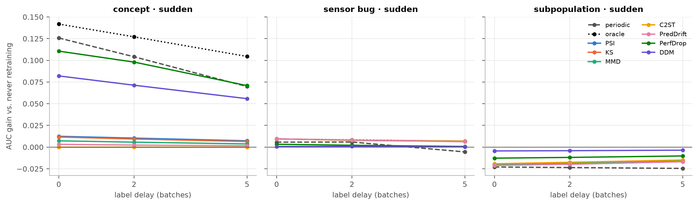

AUC gain vs. static under concept-sudden drift:

| Label delay (batches) | 0 | 2 | 5 |
|---|---|---|---|
| oracle | 0.142 | 0.127 | 0.104 |
| periodic | 0.126 | 0.104 | 0.070 |
| PerfDrop | 0.111 | 0.098 | 0.071 |
| DDM | 0.082 | 0.071 | 0.056 |
| best unsupervised (PSI) | 0.012 | 0.010 | 0.007 |

Label-based triggers lose value steadily as labels arrive later. PerfDrop loses about 36 % of its
benefit between delay 0 and delay 5, and at delay 5 it is no better than retraining every 10 batches
(0.071 vs 0.070), although it still retrains far less often. Unsupervised triggers do not depend on
labels, but they gain little on concept drift at any delay.

### 4.6 RQ5: Real-world drift (Exp 4, Elec2)

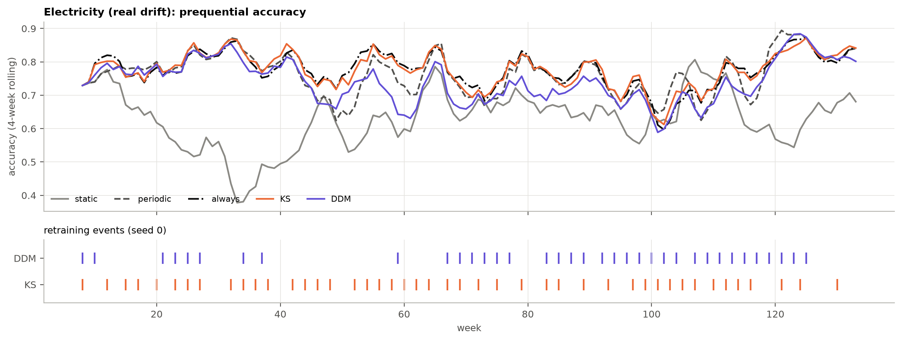

| Policy | Accuracy (±95 % CI) | ROC-AUC | Retrains (126 weeks) |
|---|---|---|---|
| **KS** | **0.778** (±0.001) | 0.879 | 45.2 |
| always | 0.778 (±0.000) | 0.881 | 126.0 |
| C2ST | 0.774 (±0.001) | 0.873 | 46.0 |
| PredDrift | 0.771 (±0.003) | 0.875 | 26.4 |
| PSI | 0.767 (±0.000) | 0.870 | 29.0 |
| periodic | 0.766 (±0.000) | 0.873 | 31.0 |
| MMD | 0.764 (±0.002) | 0.871 | 37.4 |
| DDM | 0.743 (±0.019) | 0.823 | 29.8 |
| PerfDrop | 0.690 (±0.000) | 0.817 | 5.0 |
| static | 0.628 (±0.000) | 0.665 | 0 |

**Weekly accuracy:** Friedman χ² = 265.0, p = 6.8 × 10⁻⁵² (k = 10, N = 126), CD = 1.21.

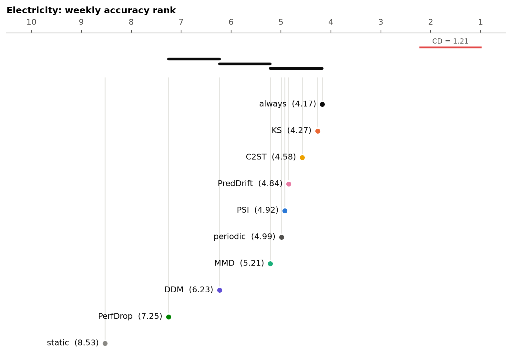

* Drift here is real and severe: the static model falls to about 40 % accuracy around week 33
  (below the majority-class rate). Every retraining policy improves on it by 6–15 accuracy points.
* **KS-triggered retraining matches retraining every week** (Holm p = 0.59) **with 64 % fewer
  retrains**, and it is statistically tied with C2ST, PredDrift, PSI and periodic.
* **The supervised triggers rank lowest among the retraining policies, which reverses the Telco
  result.** Two reasons: (a) in this market, input regimes (price and demand levels) change together
  with the label relationship, so input drift is a good proxy for harm; (b) the calibration weeks
  already differ from the training weeks, so calibration absorbs part of the real drift and pushes
  thresholds up (PerfDrop 0.17 AUC instead of the 0.05 default; PSI 1.5 instead of 0.2). As a result
  PerfDrop fires only 5 times in 2.5 years.

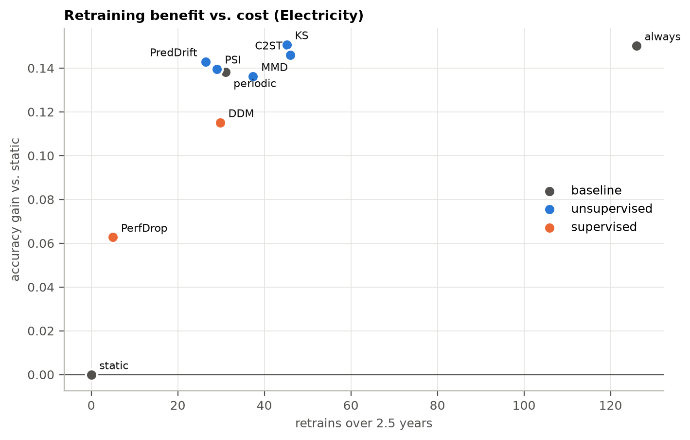

---

## 5. Threats to Validity

* **Synthetic drift on Telco.** Drift is injected, so onset and type are known exactly, but real
  drift may mix types. Elec2 provides real-world validation, but it is a single dataset.
* **One model family.** All results use gradient-boosted trees. Models that extrapolate linearly
  (e.g. logistic regression) may be hurt more by inflation and sensor-bug drift.
* **Finite data pool.** Telco streams are bootstrapped from about 1,760 rows per split. Leakage is
  controlled by a disjoint evaluation pool, but streams share rows across runs within a split.
* **Calibration of supervised detectors.** DDM (2.6 %) and PerfDrop (1.7 %) exceed the 1 %
  false-alarm target on control streams, because DDM is stateful and calibration streams use no
  label delay. This slightly favours them in detection rate.
* **Elec2 statistics.** Weekly blocks are autocorrelated, so the Friedman p-values are optimistic.
  Seeds vary only the stochastic parts of the detectors and the model, so the confidence intervals
  understate real uncertainty.
* **Fixed policy hyperparameters.** Retraining window, wait and cooldown are shared by all policies
  and are not tuned. A larger window would probably reduce the cost of unnecessary retrains.

---

## 6. Discussion

### 6.1 Answers to the research questions

* **RQ1:** At an equal false-alarm rate, PSI, KS, MMD and C2ST are statistically tied and detect
  covariate shift almost immediately. None of them can detect concept drift. Uncalibrated defaults
  raise false-alarm rates to as much as 20× the 1 % target.
* **RQ2:** Unsupervised detector sensitivity grows with the size of the input change, not with harm
  to the model. Alarm rate is therefore a poor proxy for model damage.
* **RQ3:** On Telco, label-based triggering (PerfDrop) is the best practical policy: it is tied with
  the oracle, significantly better than static, periodic and every unsupervised trigger, and it uses
  77 % fewer retrains than periodic. Unsupervised triggers are worse than never retraining.
* **RQ4:** Label delay steadily reduces the value of label-based triggers (−36 % at a 5-batch
  delay).
* **RQ5:** When drift lives in the inputs (Elec2), a calibrated KS trigger matches weekly
  retraining at about one-third of the cost. The best trigger depends on the drift mechanism, so no
  single detector should be hard-coded.

### 6.2 Implications for the churn MLOps system

1. **Keep PSI monitoring, but as a data-quality alarm, not a retraining trigger.** It reliably
   catches pipeline incidents such as the sensor bug (detected within one batch in 100 % of runs),
   and its 0.2 threshold is well calibrated at this batch size.
2. **Gate automatic retraining on labelled performance.** Churn labels arrive with a delay, so
   retraining should be triggered by a drop in AUC on the latest labelled cohort (PerfDrop), and the
   input-drift alarm should be used to start an investigation.
3. **Calibrate thresholds on clean production traffic** instead of using textbook values,
   especially for MMD and C2ST.
4. **Validate a candidate model before promotion.** Retraining can make the model worse (Section
   4.4). The project's existing quality gate and `@champion` alias in the MLflow registry already
   prevent a worse model from being promoted, and this study confirms that the gate is needed.

---

## 7. Conclusion

Drift detection and retraining are usually evaluated separately, and the industry default (input
drift alarm → automatic retraining) is rarely tested end to end. Our controlled study on churn data
shows that this default can be harmful: input detectors miss the drift that damages the model and
fire on drift that does not. Retraining on their alarms performed worse than never retraining.
Label-based triggers fix this when labels arrive reasonably fast. On a real-world stream whose drift
is driven by the inputs, a calibrated input detector is an efficient trigger. The practical lesson
for MLOps is to **calibrate detectors, separate "the data changed" from "the model got worse", and
put a validation gate between retraining and deployment.**

**Future work:** other model families; adaptive retraining windows that keep old data under
covariate shift; importance-weighted retraining; estimating performance without labels (e.g.
confidence-based performance estimation) to cover the label-delay gap.

---

## 8. Reproducibility

```bash
make research            # full study, ~70 min on 8 cores (dvc repro research/dvc.yaml)
make research-resume     # resume after interruption (skips finished stages)
make research-quick      # 5-minute smoke run (not for reporting)
```

* Protocol and every hyperparameter: `research/config.yaml`. Each stage is tracked by DVC
  (`research/dvc.yaml`), so changing a parameter re-runs only the affected stages.
* Raw logs: `research/results/*.csv.gz`. Derived tables (CSV + Markdown):
  `research/results/tables/`. Test statistics: `research/results/summary.json`. Figures (PNG +
  PDF for LaTeX): `research/figures/`.
* Run time of the reported study: calibrate 8.8 min, detection 9.3, sensitivity 5.9, retraining
  42.4, electricity 3.6.

---

## References

* Demšar, J. (2006). Statistical comparisons of classifiers over multiple data sets. *JMLR* 7, 1–30.
* Gama, J., Medas, P., Castillo, G., & Rodrigues, P. (2004). Learning with drift detection. *SBIA
  2004*, LNCS 3171, 286–295.
* Gama, J., Žliobaitė, I., Bifet, A., Pechenizkiy, M., & Bouchachia, A. (2014). A survey on concept
  drift adaptation. *ACM Computing Surveys* 46(4), 44.
* Gretton, A., Borgwardt, K., Rasch, M., Schölkopf, B., & Smola, A. (2012). A kernel two-sample
  test. *JMLR* 13, 723–773.
* Harries, M. (1999). *SPLICE-2 comparative evaluation: Electricity pricing.* Technical report,
  University of New South Wales.
* Lopez-Paz, D., & Oquab, M. (2017). Revisiting classifier two-sample tests. *ICLR 2017*.
* Moreno-Torres, J. G., Raeder, T., Alaiz-Rodríguez, R., Chawla, N. V., & Herrera, F. (2012). A
  unifying view on dataset shift in classification. *Pattern Recognition* 45(1), 521–530.
* Rabanser, S., Günnemann, S., & Lipton, Z. (2019). Failing loudly: An empirical study of methods
  for detecting dataset shift. *NeurIPS 2019*.
